<div align="center">

<!-- Animated Header -->


<br/><br/>

<!-- Avatar -->


<br/><br/>

<!-- Typing SVG -->
<a href="https://git.io/typing-svg">
  
</a>

</div>

<br/>

<!-- About Me Section -->
##  &nbsp;About Me

```yaml
name: Anas
location: France
current_focus: Full Stack Development
education: BTS SIO (SLAM)
languages: [French, English, Darija]
fun_fact: "I love building things from scratch"
```

<br/>

<!-- Tech Stack -->
##  &nbsp;Tech Stack

<div align="center">

#### Languages


#### Tools & Platforms


</div>

<br/>

<!-- GitHub Stats -->
##  &nbsp;GitHub Stats

<div align="center">


&nbsp;


<br/><br/>


</div>

<br/>

<!-- Snake Contribution Graph -->
##  &nbsp;Contribution Snake

<div align="center">

<picture>
  <source media="(prefers-color-scheme: dark)" srcset="https://raw.githubusercontent.com/ELPEDRU/ELPEDRU/output/github-snake-dark.svg" />
  <source media="(prefers-color-scheme: light)" srcset="https://raw.githubusercontent.com/ELPEDRU/ELPEDRU/output/github-snake.svg" />
  
</picture>

</div>

<br/>

<!-- Projects -->
##  &nbsp;Featured Projects

<div align="center">

<a href="https://github.com/ELPEDRU/ELPEDRU">
  
</a>

</div>

<br/>

<!-- Activity Graph -->
##  &nbsp;Activity Graph

<div align="center">

[](https://github.com/ashutosh00710/github-readme-activity-graph)

</div>

<br/>

<!-- Profile Views & Socials -->
<div align="center">


<br/><br/>

<a href="https://linkedin.com/in/anas-achak-12a160439">
  
</a>
&nbsp;
<a href="https://discord.gg/">
  
</a>

</div>

<br/>

<!-- Footer -->
<div align="center">
  
</div>
